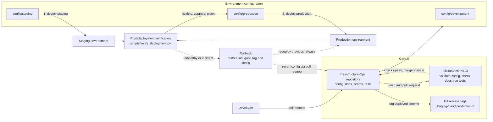

# Architecture

This document describes how configuration, validation, deployment and rollback fit together for the project. It covers only what this repository owns: environment configuration, CI validation, and the deployment and rollback procedures. Application code is built and released from the application repositories.

## Diagram

The diagram is Mermaid source embedded in this file, so GitHub renders it automatically and changes show up as reviewable text diffs.

## Components

| Component | Responsibility | Where it lives |
|---|---|---|
| Developer | Proposes configuration and documentation changes through pull requests | Local clone, GitHub |
| GitHub repository | Single source of truth for configuration, docs and scripts | This repository |
| GitHub Actions CI | Blocks invalid configuration, missing docs and failing tests before merge | `.github/workflows/ci.yml` |
| Environment configuration | Per-environment settings (`app.yaml`) and variable templates (`.env.example`) | `config/` |
| Staging environment | Production-like target used to prove a release before production | Managed by the team; settings in `config/staging/` |
| Production environment | Live target; requires approval and stricter validation rules | Managed by the team; settings in `config/production/` |
| Release tags | Mark exactly which commit was deployed, and give rollback a target | Git tags `staging-YYYYMMDD-N`, `production-YYYYMMDD-N` |
| Post-deployment verification | Confirms an environment answers its health check | `scripts/verify_deployment.py` |
| Rollback | Returns an environment to the last known good release and configuration | [rollback.md](rollback.md) |

## Flows

**Change flow.** A developer opens a pull request. CI runs on the pull request and again after merge. Nothing is merged while CI is failing.

**Deployment flow.** The deployed commit is tagged, deployed to staging and verified. After a go decision and approval, the same commit is deployed to production and verified. The steps are in [deployment.md](deployment.md).

**Rollback flow.** If verification fails or an incident is declared after deployment, the team redeploys the previous production release and restores the previous configuration from its tag. The steps are in [rollback.md](rollback.md).

## Design decisions

- **Plain files and Git tags instead of orchestration tooling.** The team is small, so the release record is a Git tag and the configuration is reviewed text. Adding more machinery would increase maintenance without reducing risk.
- **Secrets are referenced by name only.** `app.yaml` lists the variable names a deploy needs. The values live outside the repository. See [configuration.md](configuration.md).
- **Staging mirrors production.** Both use https, debug off, and the same secret names. The validator enforces this so a green staging deployment says something about production.
- **Deploying the application artifact is out of scope here.** Each environment is deployed using the mechanism the team already uses for it. This repository defines what must be true before and after that step.
